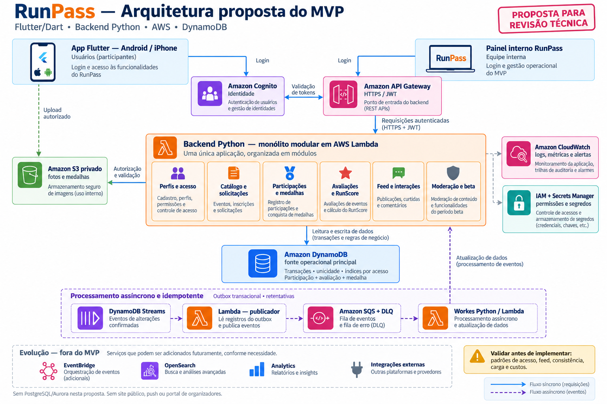

# RunPass - Projeto X

Aplicativo social para corredores de rua, com histórico de provas concluídas, medalhas, avaliações e interação entre corredores.

## Estado

Definição de produto aprovada pelo responsável. Especificação técnica em revisão; ainda não há aplicativo implementado.

## Documentação

- [PRD v2](PRD_RunPass_MVP_v2.md)
- [Artefatos PDLC](PDLC/README.md)
- [SPEC do MVP](PDLC/M4/SPEC_RunPass_MVP_v1.md)
- [Arquitetura proposta com DynamoDB](PDLC/M4/RunPass-Arquitetura-MVP-DynamoDB-v1.png)
- [Contexto e decisões](Contexto%20e%20Definicoes/RUNPASS-CONTEXTO-E-DEFINICOES.md)

## Arquitetura de solução do MVP

Proposta com DynamoDB, ainda em revisão técnica. As regras e ressalvas da SPEC prevalecem sobre a ilustração.

## Direção técnica

Flutter/Dart para Android e iPhone e Python no backend. Arquitetura AWS com DynamoDB em revisão, conforme a SPEC. Skills de apoio estão versionadas em `.agents/skills`.