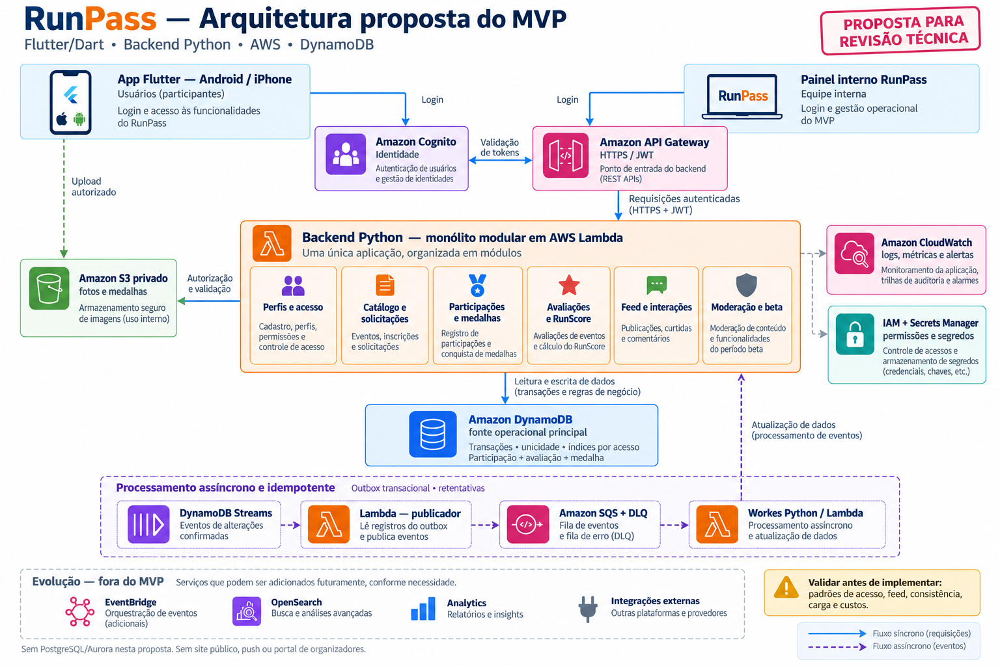

# RunPass - Projeto X

Aplicativo social para corredores de rua, com histórico de provas concluídas, medalhas, avaliações e interação entre corredores.

## Estado

Definição de produto e direções técnicas prioritárias aprovadas. S00 preparada com scaffold Flutter e verificações locais; S01 tem desenho físico e contratos aceitos. S02 implementa identidade/admissão, S03 catálogo e S04 o rascunho privado; as três implementações estão em revisão. Imagem e conclusão seguem nos próximos slices.

## Documentação

- [Desenvolvimento local e verificações](docs/desenvolvimento.md)
- [Plano de implementação](PDLC/M4/implementation-slices.md)
- [Evidências da S00](PDLC/M4/S00-preparacao-local.md)
- [Desenho e contratos da S01](PDLC/M4/S01-desenho-e-contratos.md)
- [Implementação e evidências da S02](PDLC/M4/S02-identidade-admissao.md)
- [Catálogo e demonstração local da S03](PDLC/M4/S03-catalogo.md)
- [Rascunho de participação da S04](PDLC/M4/S04-rascunho-participacao.md)
- [Testes locais das APIs com Bruno ou Insomnia](api/README.md)
- [PRD v2](PRD_RunPass_MVP_v2.md)
- [Artefatos PDLC](PDLC/README.md)
- [SPEC do MVP](PDLC/M4/SPEC_RunPass_MVP_v1.md)
- [Arquitetura proposta com DynamoDB](PDLC/M4/RunPass-Arquitetura-MVP-DynamoDB-v1.png)
- [Contexto e decisões](Contexto%20e%20Definicoes/RUNPASS-CONTEXTO-E-DEFINICOES.md)

## Arquitetura de solução do MVP

Proposta com DynamoDB, ainda em revisão técnica. As regras e ressalvas da SPEC prevalecem sobre a ilustração.

## Direção técnica

Flutter/Dart para Android e iPhone e Python no backend. Arquitetura AWS com DynamoDB em revisão, conforme a SPEC. Skills de apoio estão versionadas em `.agents/skills`.
